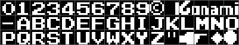
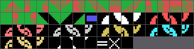

# The cartridge

Sixteen kilobytes in the MSX's page 1, from 0x4000 to 0x7FFF. The game takes up
8,115 bytes: from 0x5FB3 onwards there are 8,269 bytes of 0xFF in a row, chip
padding that no instruction ever reads.

## The sixteen header bytes

    41 42 5F 40 00 00 00 00 00 00 00 00 00 00 00 00
    A  B  INIT=0x405F

`AB` is the signature the BIOS looks for at boot, and behind it come four
pointers. This cartridge declares only the first one, INIT; the other three —
STATEMENT, DEVICE and TEXT — are zero.

## What INIT leaves set up

0x405F does this, in order:

1. Installs `jp 0x4034` in the **H.KEYI** hook (0xFD9A), the one the BIOS calls
   on every interrupt.
2. Puts the stack at 0xE400 and clears the 4 KB from 0xE000 to 0xEFFF.
3. Programs the eight VDP registers and clears the 16 KB of VRAM.
4. Loads the four sets of artwork: the Konami logo, the table tiles, the font and
   the big title lettering.
5. Drops into `jr $` (0x409E) and **never comes out**.

From then on the main thread does nothing. The whole game runs inside the
interrupt, which is the usual arrangement in Konami cartridges of this period.

## The screen

SCREEN 2, with the register table at 0x46BE:

| table | address |
|---|---|
| names | 0x3800 |
| patterns | 0x2000, in three thirds of 0x800 |
| colours | 0x0000, in three thirds as well |
| sprite attributes | 0x3B00 |
| sprite patterns | 0x1800, 16×16 |

In SCREEN 2 the character generator is three independent tables, one per third of
the screen, which is why nearly every load in the cartridge repeats the same copy
three times adding 0x800. The exception is the big title lettering (0x5766),
loaded into the first third only: that is where its two rows fall.

## The two drawing interpreters

Almost nothing is copied raw. There are two formats, and both turn up all over
the cartridge.

**Format A**, read by 0x472E: two destination bytes in VRAM and then the tile
numbers, with 0xFE to change destination and 0xFF to finish. Every text label
uses it.

It has a nice touch: the same list serves to draw and to erase. Entering at
0x472A instead of 0x472E, the only difference is that C holds 0x00 rather than
0xFF, and down in the loop there is an `and c` that turns every tile into a zero.
The menu's blinking is the two entry points of one routine over one list.

**Format B**, read by 0x4969: a stream of commands where bit 7 separates the two
cases. With the bit set, the low seven say how many literal bytes follow; without
it, how many times the next byte repeats. 0x00 closes the block and 0xFF means
another destination follows. The Konami logo, the table colours and the whole
table plan are compressed with it.

## The letters are its own

The 48 glyphs at 0x4136 are loaded into tiles 0x30 to 0x5F, and those numbers are
exactly the ASCII codes of the characters they draw: the digits, a few symbols
and the capitals.

That is why the cartridge's text lists spell the words out literally, in ASCII,
with no conversion table in between. In the slot where ASCII has the backslash,
the bracket and the underscores (0x5C to 0x5F) sit four drawings of its own: the
two menu cursor tiles, a diamond and a filled ball, which are the ones that draw
the goes and the spare balls on the scoreboard.

## The table artwork

The 59 table tiles are copied verbatim from 0x4A70, but their colours come
compressed separately at 0x4C40. And there is a deliberate overlap there: **the
first eight bytes of the colour block are also the last eight of the pattern
copy**. Konami spliced the two tables to save eight bytes.

There is a second overlap, and a stranger one. The sprite patterns are copied
from 0x4B30, which sits inside the table tiles: **the balls and the cloth
drawings are the same bytes read two ways**.

288 bytes are copied, enough for nine 16×16 sprites, but only eight are real
drawings: the cue ball, the six numbered ones and the aiming dot. The ninth
overruns the end and lands on the table's compressed colours. Nothing uses it.

## The table plan

The table is not stored as a screen of 768 tiles. At 0x4C59 there is a strip of
groups, and each group is a number followed by a format B block: the number says
how many consecutive rows carry that same drawing. The routine that unrolls it
(0x4A39) draws the block and steps down 32 bytes at a time from row 7, reloading
the pointer on each pass because the interpreter leaves it at the end. A zero
closes the plan.

Seven groups covering sixteen rows, from 7 to 22, in 79 bytes.

## The mark that is not there

Manuel Pazos found that Konami cartridges of this period hide their RC-7xx
catalogue number and the game's title in katakana at the end of the ROM. This one
does not: there is not a single `RC-7` in ASCII in the 16 KB, and the end of the
chip is 0xFF all the way.

The RC-706 this cartridge is known by comes from the catalogue, not from the
binary.
