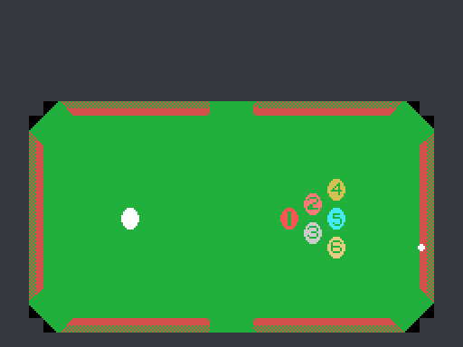

# The game

An American pool table seen from above, with six pockets, and a cue ball you use
to sink the six coloured ones. You aim by moving a dot that travels around the
outside of the table, and you shoot when the power bar is where you want it.

## Aiming is moving a dot around the edge

That small thing to the right of the cloth is the aiming point, and it is not
decoration: it is the eighth entry of the ball array (0xE170). When you shoot,
the game subtracts the cue ball's position from it, and out of that difference
come the direction and the distance of the shot.

The aiming point does not move freely. It only travels along **one axis at a
time**, whichever bit 0 of 0xE1F9 says, and that bit flips when it reaches the
stops: X stays between 0x0E and 0xE1, Y between 0x36 and 0xA9. With those two
rules, the places it can be are the perimeter of a rectangle surrounding the
table, so aiming means picking a point on that frame.

## Power is not chosen, it is caught

The **SPEED** indicator at the bottom left does not respond to the keys. The very
routine that draws it (0x5314) also advances it one step each time it is called,
cycling 1, 2, 3, 1, 2, 3… The call comes in once every 64 frames, a little over a
second.

So a soft or a hard shot is not decided, it is caught on the fly by pressing the
button at the right moment. The cue ball's starting velocity is the power plus
one times the direction vector, and its energy is 0x20 per unit.

## REST: three goes per ball

To the right of the scoreboard there are up to four diamonds: they are the goes
left to the ball in play (0xE053). You start with two, and every shot that sinks
nothing spends one; when they run out, the warning sounds and the ball is lost.

You start with **three spare balls** and earn one when the score passes a
threshold that climbs five thousand at a time (0xE052), and another every time
the whole table is cleared.

## What the balls are worth

Each ball is worth **its number times a hundred**, and that is where the
multiplier comes in: for every ball sunk in a row without missing, the count
doubles. The table is 1, 2, 4, 8 and 16, and it stops at 16.

The tally card shows the balls you have earned one by one at the end of the shot,
each with the multiplier it got. The **RATE** label on the left shows, while you
are aiming, the one that will apply to the next.

## The cue ball penalty

If the cue ball goes down a pocket, you do not just lose the turn: **every ball
sunk during that shot goes back on the cloth**. The routine that does it (0x5A3A)
removes them from the row of earned balls at the top and finds each one a free
spot on the table before putting it back, starting at Y=0x70 X=0x90 and shifting
eight pixels along whenever the place is taken.

Since they never reach the tally, those balls are never scored.

## Two players, one shared stage

The menu lets you pick one or two players, and the game keeps each player's spare
balls, extra-ball threshold and goes. The 1P or 2P label of whoever has the turn
blinks, one frame in every thirty-two, by reading the screen itself to find out
whether it was on or off: there is no blink variable.

What is **not** shared out is the stage number. The swap at 0x4526 skips 0xE051
on purpose, so both players advance through the same STAGE counter.

## The machine playing on its own

If nobody touches anything, the game runs its own demonstration, and there is no
separate code for it: it measures the angle from the cue ball to the first ball
still on the table, moves the aiming point until they match and then **writes the
fire button into the same variables where the game leaves the player's keys**. It
presses the button on itself.

During the attract mode, bit 6 of 0xE002 is clear, and that bit is the one that
allows scoring and the one that lets sounds be requested the normal way: the
demonstration neither scores nor makes a noise.
