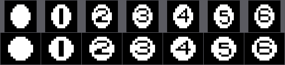

# El cartucho

Dieciséis kilobytes en la página 1 del MSX, de 0x4000 a 0x7FFF. El juego ocupa
8.115 bytes: de 0x5FB3 en adelante son 8.269 bytes de 0xFF seguidos, relleno del
chip que ninguna instrucción lee.

## Los dieciséis bytes de la cabecera

    41 42 5F 40 00 00 00 00 00 00 00 00 00 00 00 00
    A  B  INIT=0x405F

`AB` es la firma que busca la BIOS al arrancar, y detrás van cuatro punteros. Este
cartucho solo declara el primero, INIT; los otros tres —STATEMENT, DEVICE y
TEXT— están a cero.

## Lo que el INIT deja montado

0x405F hace, por este orden:

1. Instala `jp 0x4034` en el gancho **H.KEYI** (0xFD9A), que es al que la BIOS
   llama en cada interrupción.
2. Pone la pila en 0xE400 y borra los 4 KB de 0xE000 a 0xEFFF.
3. Programa los ocho registros del VDP y borra los 16 KB de VRAM.
4. Carga los cuatro juegos de dibujos: el logotipo de Konami, los tiles de la
   mesa, la fuente y el rótulo grande del título.
5. Se mete en `jr $` (0x409E) y **no sale nunca**.

A partir de ahí el hilo principal no hace nada. El juego entero corre dentro de
la interrupción, que es lo normal en los cartuchos de Konami de esta época.

## La pantalla

SCREEN 2 con la tabla de registros de 0x46BE:

| tabla | dirección |
|---|---|
| nombres | 0x3800 |
| patrones | 0x2000, en tres tercios de 0x800 |
| colores | 0x0000, también en tres tercios |
| atributos de sprite | 0x3B00 |
| patrones de sprite | 0x1800, de 16×16 |

En SCREEN 2 el generador de caracteres son tres tablas independientes, una por
cada tercio de la pantalla, y por eso casi todas las cargas del cartucho repiten
la misma copia tres veces sumando 0x800. La excepción es el rótulo grande del
título (0x5766), que solo se carga en el primer tercio: es donde caen sus dos
filas.

## Los dos intérpretes de dibujo

Casi nada se copia a pelo. Hay dos formatos, y los dos aparecen por todo el
cartucho.

**Formato A**, que lee 0x472E: dos bytes de destino en VRAM y detrás los
números de tile, con 0xFE para cambiar de destino y 0xFF para terminar. Lo usan
todos los rótulos de texto.

Tiene un detalle bonito: la misma lista sirve para pintar y para borrar. Entrando
por 0x472A en vez de por 0x472E, lo único que cambia es que C vale 0x00 en lugar
de 0xFF, y abajo hay un `and c` que convierte cada tile en un cero. El parpadeo
del menú son las dos entradas de la misma rutina sobre la misma lista.

**Formato B**, que lee 0x4969: una tira de órdenes donde el bit 7 separa los dos
casos. Con el bit puesto, los siete de abajo dicen cuántos bytes literales
vienen; sin él, cuántas veces se repite el byte que sigue. 0x00 cierra el bloque
y 0xFF dice que viene otro destino. Con eso van comprimidos el logotipo de
Konami, los colores de la mesa y el plano de la mesa entera.

## Las letras son suyas

Los 48 glifos de 0x4136 se cargan en los tiles 0x30 a 0x5F, y esos números son
exactamente el ASCII de los caracteres que dibujan: los dígitos, unos cuantos
símbolos y las mayúsculas.

Por eso las listas de texto del cartucho escriben las palabras tal cual, en
ASCII, sin tabla de conversión de por medio. En el hueco donde el ASCII tiene la
barra, el corchete y los guiones (0x5C a 0x5F) hay cuatro dibujos propios: los
dos tiles del cursor del menú, un rombo y una bola rellena, que son los que
pintan los intentos y las bolas de reserva del marcador.

## Los dibujos de la mesa

Los 59 tiles de la mesa se copian tal cual desde 0x4A70, pero sus colores vienen
comprimidos aparte en 0x4C40. Y ahí hay un solape deliberado: **los ocho
primeros bytes del bloque de colores son también los ocho últimos de la copia de
patrones**. Konami empalmó las dos tablas para ahorrar ocho bytes.

Hay un segundo solape, y este más raro. Los patrones de sprite se copian desde
0x4B30, que está dentro de los tiles de la mesa: **las bolas y los dibujos del
paño son los mismos bytes leídos de dos maneras**.

Se copian 288 bytes, que dan para nueve sprites de 16×16, pero solo ocho son
dibujos de verdad: la bola blanca, las seis numeradas y el punto de la mira. El
noveno se pasa del final y cae sobre los colores comprimidos de la mesa. No lo
usa nadie.

## Las bolas no son redondas, y por eso se ven redondas

Midiendo los propios patrones, el dibujo de una bola ocupa **diez píxeles de
ancho por doce de alto**. Con el píxel cuadrado de un monitor de hoy —la fila de
arriba— eso es un óvalo, y se nota.

La fila de abajo es el mismo dibujo con cada píxel pintado **cinco de ancho por
cuatro de alto**, que es la proporción que se le atribuye al píxel de un MSX en
un televisor de la época. Los 10×12 pasan a ser 50×48: redondos, con un 4 % de
diferencia.

La proporción que dejaría las bolas *exactamente* circulares es 12/10, o sea
**6:5**, que cae entre las dos cifras que se citan de costumbre para el píxel
del MSX. Eso sí sale del cartucho; cuánto vale de verdad el píxel de un MSX
depende del televisor, y el binario no lo dice.

La imagen la dibuja `tools/graficos.py` desde los bytes de la ROM.

### Y el código, ¿lo tiene en cuenta?

**No. La física trabaja 1:1**, y se puede señalar con el dedo:

- `busca_choques` (0x4F25) hace la primera criba con `cp 00Ch` sobre la
  diferencia de Y **y el mismo `cp 00Ch`** sobre la de X: doce píxeles en los
  dos ejes;
- `resuelve_el_choque` (0x4F63) confirma con Pitágoras, y trata las dos
  componentes con las mismas instrucciones —el mismo desplazamiento de cuatro
  bits, el mismo cuadrado— antes de sumarlas;
- `calcula_el_tiro` (0x4CA8) saca la distancia al punto de mira igual, dY y dX
  al cuadrado y la raíz;
- `saca_la_pendiente_del_vector` (0x5430) divide las dos componentes por 32 y
  compara, sin favorecer a ninguna;
- y las tablas de seno y coseno son las de un espacio isótropo.

O sea que las bolas se ven redondas y se comportan como si el espacio fuera
cuadrado. En la práctica eso quiere decir que **una bola cubre más distancia
real por píxel en vertical que en horizontal**, y que un ángulo de 45° en el
código no se ve como 45° en la pantalla. Es la solución de la época, y es la
barata: corregir la proporción costaría una multiplicación por cada eje en cada
choque.

Lo apuntó [theNestruo](https://github.com/theNestruo) en la primera issue de
este repositorio.

## El plano de la mesa

La mesa no se guarda como una pantalla de 768 tiles. En 0x4C59 hay una tira de
grupos, y cada grupo es un número seguido de un bloque en formato B: el número
dice cuántas filas seguidas llevan ese mismo dibujo. La rutina que lo despliega
(0x4A39) va pintando el bloque y bajando de 32 en 32 desde la fila 7, y recarga
el puntero en cada vuelta porque el intérprete se lo deja al final. Un cero
cierra el plano.

Son siete grupos que cubren dieciséis filas, de la 7 a la 22, en 79 bytes.

## La marca que no está

Manuel Pazos descubrió que los cartuchos de Konami de esta época esconden al
final de la ROM su número de catálogo RC-7xx y el título del juego en katakana.
En este no está: no hay un solo `RC-7` en ASCII en los 16 KB, y el final del chip
son 0xFF hasta arriba.

El RC-706 con el que se conoce este cartucho sale del catálogo, no del binario.
